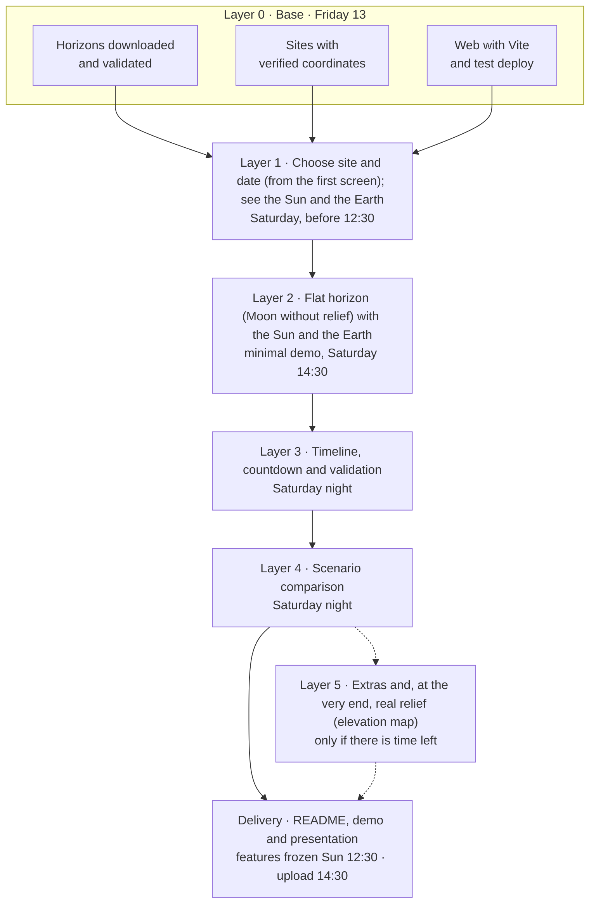

> 🇪🇸 [Leer en español](README.md)

# Lunar Landing Site Navigator

> NASA Space Apps Challenge 2026. Project in progress.

**If I land at this place on the Moon on this date, will I have Sun and will I be able to talk to Earth?**

Near the lunar south pole the Sun and the Earth barely peek above the horizon, and any mountain hides them. This tool takes a site and a date, calculates where the Sun and the Earth are, draws the real horizon of the place, and shows when there is energy and when there is communication.

## How it works
1. **Ephemerides** (Python + JPL Horizons API): azimuth and elevation of the Sun and the Earth per site and per hour.
2. **Terrain** (Python + LOLA elevation map): horizon profile of 360 directions per site.
3. **Web**: reads that precalculated data and compares each body against the horizon.

The positions of the Sun and the Earth come from [JPL Horizons](https://ssd.jpl.nasa.gov/horizons/); the sites and the terrain are explored with Quickmap and Moon Trek, the official resources of the challenge.

## Project map
The work is split into layers (phases). Each layer is an **epic** on the board (`[EPICA] ...`) and a complete demo on its own: if something falls behind, the last working layer is shown.



Mandatory: layers 0 to 4. Optional: layer 5. The issues of each layer, the schedule and the milestones are in [`docs/en/05-ROADMAP.md`](docs/en/05-ROADMAP.md).

## Structure
| Folder | Contents |
|---|---|
| `docs/` | Context, PRD, architecture, data contract, workflow, roadmap, pitch, ADRs (Spanish originals; English versions in `docs/en/`) |
| `precompute/` | Python scripts that generate the data (`ephemeris/`, `terrain/`) |
| `web/` | Web app (Vite) |
| `data/public/` | Precalculated JSON files consumed by the web app |
| `data/schema/` | JSON schemas of the data contract |
| `tests/` | Contract tests and validation against Horizons |

## How to run it
Status: the structure is ready; the code is still being built. The final commands are added as they become available.

```bash
# Git hooks (once after cloning)
git config core.hooksPath .githooks
# Commits (in English): first line of 10+ words, suggested type(scope): description. No commits on main.

# Python (precalculation and tests). Tested with Python 3.12; Python 3.8, found on some systems, does not work.
python3.12 -m venv .venv         # or with uv: uv venv --python 3.12
source .venv/bin/activate        # Windows: .venv\Scripts\activate
pip install -r precompute/requirements.txt   # with uv: uv pip install -r precompute/requirements.txt
python -m pytest tests/          # includes tests/test_environment.py, which checks that the libraries import

# Web (Vite; serves data/public/ as a static folder)
cd web && npm ci && npm run dev   # http://localhost:5173 and /sites.json
```

Deployed version (Vercel): https://vizcachasfueradeorbita.vercel.app/

Test version deployed (GitHub Pages, from `main`): https://vainstubtomas.github.io/NASA-APP-CHALLENGE/

The heavy data (elevation map and Horizons query cache) is not in the repo. See `docs/en/02-ARCHITECTURE.md` and ADR-006 to learn where it comes from.

## Documentation
Start with [`docs/en/00-CONTEXT.md`](docs/en/00-CONTEXT.md). Spanish originals are in [`docs/`](docs/) (start with [`docs/00-CONTEXT.md`](docs/00-CONTEXT.md)). To work with Claude, see [`CLAUDE.md`](CLAUDE.md).
