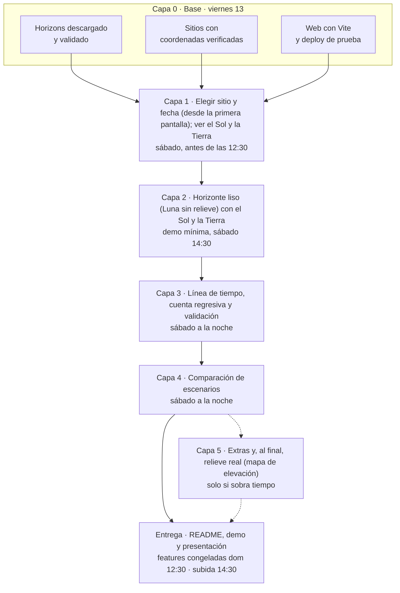

> 🇬🇧 [Read in English](README.md)

# Lunar Landing Site Navigator

> NASA Space Apps Challenge 2026. Proyecto en desarrollo.

**¿Si aterrizo en este lugar de la Luna en esta fecha, voy a tener Sol y voy a poder hablar con la Tierra?**

Cerca del polo sur lunar el Sol y la Tierra apenas asoman sobre el horizonte, y cualquier montaña los tapa. Esta herramienta toma un sitio y una fecha, busca dónde están el Sol y la Tierra, los dibuja sobre el horizonte del lugar y muestra cuándo hay energía y cuándo hay comunicación. Por ahora el horizonte es ideal (Luna lisa, sin relieve) y la web lo avisa; el relieve real de LOLA es el paso siguiente (ADR-011).

## Cómo funciona
1. **Efemérides** (Python + API de JPL Horizons): azimut y elevación del Sol y la Tierra por sitio y por hora.
2. **Terreno** (Python): perfil de horizonte de 360 direcciones por sitio. Hoy es plano (0°); el mapa de elevación LOLA va al final (ADR-011).
3. **Web**: lee esos datos precalculados y compara cada cuerpo contra el horizonte.

Además, una **API en vivo** (FastAPI, [`data/api/`](data/api/)) permite elegir cualquier latitud y longitud de la Luna: consulta a Horizons y responde en el mismo formato. Es opcional; sin ella la web usa solo los sitios precalculados. Guía: [`docs/09-API.md`](docs/09-API.md).

**La comparación de escenarios no elige un ganador.** Pone 2 o 3 escenarios de sitio y fecha lado a lado y, por cada métrica por separado, marca cuál tiene más horas de Sol (energía) y cuál más horas con la Tierra visible (comunicación). Cuál conviene depende de los requisitos de la misión, así que esa decisión la toma la persona que usa la herramienta (ADR-017).

Las posiciones del Sol y la Tierra salen de [JPL Horizons](https://ssd.jpl.nasa.gov/horizons/); los sitios y el terreno se exploran con Quickmap y Moon Trek, los recursos oficiales del desafío.

## Mapa del proyecto
El trabajo se divide en capas (fases). Cada capa es una **épica** en el tablero (`[EPICA] ...`) y una demo completa por sí sola: si algo se atrasa, se muestra la última capa que funcione.



Obligatorias: capas 0 a 4. Opcional: capa 5. Los issues de cada capa, los horarios y los hitos están en [`docs/05-ROADMAP.md`](docs/05-ROADMAP.md).

## Estructura
| Carpeta | Contenido |
|---|---|
| `docs/` | Contexto, PRD, arquitectura, contrato de datos, flujo de trabajo, roadmap, ADRs |
| `precompute/` | Scripts Python que generan los datos (`ephemeris/`, `terrain/`) |
| `web/` | Web (Vite) |
| `data/public/` | JSON precalculados que consume la web |
| `data/api/` | API en vivo (FastAPI): efemérides de una posición libre de la Luna (ADR-015) |
| `data/schema/` | Esquemas JSON del contrato de datos |
| `tests/` | Pruebas del contrato y validación contra Horizons |

## Cómo correrlo
Requisitos: Node.js 20 o más nuevo para la web y Python 3.12 para el precálculo y los tests.

```bash
# Hooks de Git (una vez después de clonar)
git config core.hooksPath .githooks
# Commits (in English): first line of 10+ words, suggested type(scope): description. No commits on main.

# Python (precálculo y tests). Probado con Python 3.12; el Python 3.8 de algunos sistemas no sirve.
python3.12 -m venv .venv         # o con uv: uv venv --python 3.12
source .venv/bin/activate        # Windows: .venv\Scripts\activate
pip install -r precompute/requirements.txt   # con uv: uv pip install -r precompute/requirements.txt
python -m pytest tests/          # incluye tests/test_environment.py, que revisa que las librerías importen

# Web (Vite; sirve data/public/ como carpeta estática)
cd web && npm ci && npm run dev   # http://localhost:5173 y /sites.json

# API en vivo (opcional, desde la raíz del repo): Swagger en http://localhost:8000/docs
python -m uvicorn data.api.main:app --reload --port 8000
# Para que la web la use: crear web/.env.local con VITE_API_URL=http://localhost:8000
```

Versión desplegada (Vercel): https://vizcachasfueradeorbita.vercel.app/

Versión de prueba desplegada (GitHub Pages, desde `main`): https://vainstubtomas.github.io/NASA-APP-CHALLENGE/

Los datos pesados (mapa de elevación y caché de consultas a Horizons) no están en el repo. Ver `docs/02-ARCHITECTURE.md` y el ADR-006 para saber de dónde salen.

## Documentación
Empezar por [`docs/00-CONTEXT.md`](docs/00-CONTEXT.md). Para trabajar con Claude, ver [`CLAUDE.md`](CLAUDE.md). El borrador del formulario de entrega de Space Apps está en [`docs/08-SUBMISSION.md`](docs/08-SUBMISSION.md). La API en vivo se explica en [`docs/09-API.md`](docs/09-API.md).

## Uso de IA
Usamos herramientas de IA, como permiten las reglas de Space Apps, y decimos dónde:
- **Código, tests y documentación**: escritos con ayuda de Claude (Anthropic), usado como asistente de programación dentro de nuestro flujo de Git. Los commits en los que participó llevan la línea `Co-Authored-By: Claude`, y cada cambio pasó por un pull request revisado por alguien del equipo. La guía que le damos está en [`CLAUDE.md`](CLAUDE.md).
- **Traducciones**: los textos de la web en inglés, hindi y chino simplificado se tradujeron con IA y no los revisaron hablantes nativos (ver [`web/src/i18n/README.md`](web/src/i18n/README.md)). La web también lo dice en el pie.
- **Lo que no generó la IA**: los números. Las posiciones del Sol y la Tierra salen de JPL Horizons y se comparan contra respuestas guardadas de Horizons con tests automáticos (ADR-005, ADR-013).
- Ninguna imagen, video ni audio del proyecto se generó con IA.

## Créditos y referencias
**Datos y recursos de NASA**
- [JPL Horizons](https://ssd.jpl.nasa.gov/horizons/) (NASA/JPL): azimut y elevación del Sol y la Tierra por sitio y por hora. Fuente de todos los números de la web.
- [Quickmap](https://quickmap.lroc.asu.edu/) (Arizona State University, datos del Lunar Reconnaissance Orbiter): verificación de coordenadas y terreno de los sitios.
- [Moon Trek](https://trek.nasa.gov/moon/) (NASA): exploración de los sitios y su topografía.

**Recursos de agencias espaciales socias**
- [Moon Exploration](https://www.asc-csa.gc.ca/eng/astronomy/moon-exploration/) (CSA, Agencia Espacial Canadiense): contexto para el pitch.

**Coordenadas de los sitios**: cada sitio de [`data/public/sites.json`](data/public/sites.json) indica su fuente.

**Software de código abierto**
- Web: [three.js](https://threejs.org/) (MIT) para la vista 3D, [Vite](https://vite.dev/) (MIT) para el build.
- Python: [NumPy](https://numpy.org/) (BSD-3-Clause), [Requests](https://requests.readthedocs.io/) (Apache-2.0), [rasterio](https://rasterio.readthedocs.io/) (BSD-3-Clause), [pyproj](https://pyproj4.github.io/pyproj/) (MIT), [Matplotlib](https://matplotlib.org/) (licencia de Matplotlib), [pytest](https://pytest.org/) (MIT), [jsonschema](https://python-jsonschema.readthedocs.io/) (MIT); para la API en vivo (ADR-015): [FastAPI](https://fastapi.tiangolo.com/) (MIT), [Uvicorn](https://www.uvicorn.org/) (BSD-3-Clause), [HTTPX](https://www.python-httpx.org/) (BSD-3-Clause).

No se usan logos ni otros elementos de marca de NASA.

## Licencia
El código se publica con la [licencia MIT](LICENSE). Los datos vienen de las fuentes de arriba, con sus propias condiciones.
