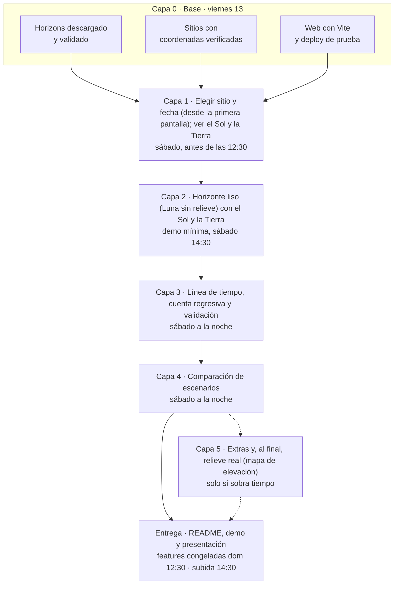

# Lunar Landing Site Navigator

> NASA Space Apps Challenge 2026. Proyecto en desarrollo.

**¿Si aterrizo en este lugar de la Luna en esta fecha, voy a tener Sol y voy a poder hablar con la Tierra?**

Cerca del polo sur lunar el Sol y la Tierra apenas asoman sobre el horizonte, y cualquier montaña los tapa. Esta herramienta toma un sitio y una fecha, calcula dónde están el Sol y la Tierra, dibuja el horizonte real del lugar y muestra cuándo hay energía y cuándo hay comunicación.

## Cómo funciona
1. **Efemérides** (Python + API de JPL Horizons): azimut y elevación del Sol y la Tierra por sitio y por hora.
2. **Terreno** (Python + mapa de elevación LOLA): perfil de horizonte de 360 direcciones por sitio.
3. **Web**: lee esos datos precalculados y compara cada cuerpo contra el horizonte.

Las posiciones del Sol y la Tierra salen de [JPL Horizons](https://ssd.jpl.nasa.gov/horizons/); los sitios y el terreno se exploran con Quickmap y Moon Trek, los recursos oficiales del desafío.

## Mapa del proyecto
El trabajo se divide en capas (fases). Cada capa es una **épica** en el tablero (`[EPICA] ...`) y una demo completa por sí sola: si algo se atrasa, se muestra la última capa que funcione.



Obligatorias: capas 0 a 4. Opcional: capa 5. Los issues de cada capa, los horarios y los hitos están en [`docs/05-ROADMAP.md`](docs/05-ROADMAP.md).

## Estructura
| Carpeta | Contenido |
|---|---|
| `docs/` | Contexto, PRD, arquitectura, contrato de datos, flujo de trabajo, roadmap, ADRs |
| `precompute/` | Scripts Python que generan los datos (`ephemeris/`, `terrain/`) |
| `web/` | Web (Vite) |
| `data/public/` | JSON precalculados que consume la web |
| `data/schema/` | Esquemas JSON del contrato de datos |
| `tests/` | Pruebas del contrato y validación contra Horizons |

## Cómo correrlo
Estado: la estructura está lista; el código se está construyendo. Los comandos definitivos se completan a medida que existen.

```bash
# Hooks de Git (una vez después de clonar)
git config core.hooksPath .githooks
# Commits (in English): first line of 10+ words, suggested type(scope): description. No commits on main.

# Python (precálculo y tests). Probado con Python 3.12; el Python 3.8 de algunos sistemas no sirve.
python3.12 -m venv .venv         # o con uv: uv venv --python 3.12
source .venv/bin/activate        # Windows: .venv\Scripts\activate
pip install -r precompute/requirements.txt   # con uv: uv pip install -r precompute/requirements.txt
python -m pytest tests/          # incluye tests/test_environment.py, que revisa que las librerías importen

# Web (cuando exista web/package.json)
cd web && npm install && npm run dev
```

Los datos pesados (mapa de elevación y caché de consultas a Horizons) no están en el repo. Ver `docs/02-ARCHITECTURE.md` y el ADR-006 para saber de dónde salen.

## Documentación
Empezar por [`docs/00-CONTEXT.md`](docs/00-CONTEXT.md). Para trabajar con Claude, ver [`CLAUDE.md`](CLAUDE.md).
