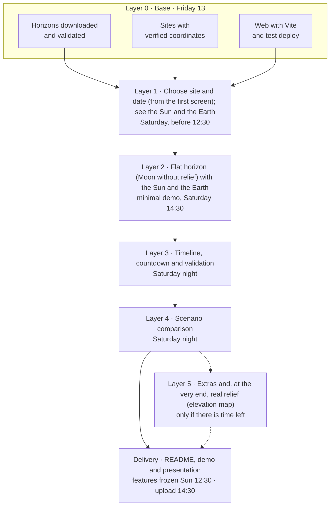

> 🇪🇸 [Leer en español](README.es.md)

# Lunar Landing Site Navigator

> NASA Space Apps Challenge 2026. Project in progress.

**If I land at this place on the Moon on this date, will I have Sun and will I be able to talk to Earth?**

Near the lunar south pole the Sun and the Earth barely peek above the horizon, and any mountain hides them. This tool takes a site and a date, finds where the Sun and the Earth are, draws them over the horizon of the place, and shows when there is energy and when there is communication. The horizon uses real terrain from LOLA for the sites with elevation data, so a mountain can hide the Sun or the Earth; sites without that data (for example a free latitude and longitude from the live API) keep an ideal horizon (a smooth Moon, no terrain), and the app says so (ADR-011).

## How it works
1. **Ephemerides** (Python + JPL Horizons API): azimuth and elevation of the Sun and the Earth per site and per hour.
2. **Terrain** (Python): horizon profile of 360 directions per site. It comes from the LOLA elevation map for the sites it covers and stays flat (0°) for the rest (ADR-011).
3. **Web**: reads that precalculated data and compares each body against the horizon.

In addition, a **live API** (FastAPI, [`data/api/`](data/api/)) lets the user pick any latitude and longitude on the Moon: it queries Horizons and answers in the same format. It is optional; without it the web app uses only the precomputed sites. Guide: [`docs/en/09-API.md`](docs/en/09-API.md).

In the sky view, the silhouette of the horizon is real terrain (LOLA) for the sites with elevation data, and it is lit by the Sun and the Earth at the chosen time. The ground drawn below the horizon (craters and texture) is **illustrative**, not real topography (ADR-016).

**The scenario comparison does not pick a winner.** It puts 2 or 3 site-date scenarios side by side and, for each metric separately, marks which one has more hours of Sun (power) and which has more hours of Earth in view (communication). Which one is better depends on the requirements of the mission, so that decision is left to the user (ADR-017).

The positions of the Sun and the Earth come from [JPL Horizons](https://ssd.jpl.nasa.gov/horizons/); the sites and the terrain are explored with Quickmap and Moon Trek, the official resources of the challenge.

## Project map
The work is split into layers (phases). Each layer is an **epic** on the board (`[EPICA] ...`) and a complete demo on its own: if something falls behind, the last working layer is shown.



Mandatory: layers 0 to 4. Optional: layer 5. The issues of each layer, the schedule and the milestones are in [`docs/en/05-ROADMAP.md`](docs/en/05-ROADMAP.md).

## Structure
| Folder | Contents |
|---|---|
| `docs/` | Context, PRD, architecture, data contract, workflow, roadmap, pitch, ADRs (Spanish originals; English versions in `docs/en/`) |
| `precompute/` | Python scripts that generate the data (`ephemeris/`, `terrain/`) |
| `web/` | Web app (Vite) |
| `data/public/` | Precalculated JSON files consumed by the web app |
| `data/api/` | Live API (FastAPI): ephemerides for a free position on the Moon (ADR-015) |
| `data/schema/` | JSON schemas of the data contract |
| `tests/` | Contract tests and validation against Horizons |

## How to run it
Requirements: Node.js 20+ for the web app and Python 3.12 for the precalculation and the tests.

```bash
# Git hooks (once after cloning)
git config core.hooksPath .githooks
# Commits (in English): first line of 10+ words, suggested type(scope): description. No commits on main.

# Python (precalculation and tests). Tested with Python 3.12; Python 3.8, found on some systems, does not work.
python3.12 -m venv .venv         # or with uv: uv venv --python 3.12
source .venv/bin/activate        # Windows: .venv\Scripts\activate
pip install -r precompute/requirements.txt   # with uv: uv pip install -r precompute/requirements.txt
python -m pytest tests/          # includes tests/test_environment.py, which checks that the libraries import

# Web (Vite; serves data/public/ as a static folder)
cd web && npm ci && npm run dev   # http://localhost:5173 and /sites.json

# Live API (optional, from the repo root): Swagger at http://localhost:8000/docs
python -m uvicorn data.api.main:app --reload --port 8000
# For the web app to use it: create web/.env.local with VITE_API_URL=http://localhost:8000
```

Deployed version (Vercel): https://vizcachasfueradeorbita.vercel.app/

Test version deployed (GitHub Pages, from `main`): https://vainstubtomas.github.io/NASA-APP-CHALLENGE/

The heavy data (elevation map and Horizons query cache) is not in the repo. See `docs/en/02-ARCHITECTURE.md` and ADR-006 to learn where it comes from.

## Documentation
Start with [`docs/en/00-CONTEXT.md`](docs/en/00-CONTEXT.md). Spanish originals are in [`docs/`](docs/) (start with [`docs/00-CONTEXT.md`](docs/00-CONTEXT.md)). To work with Claude, see [`CLAUDE.md`](CLAUDE.md). The Space Apps submission form draft is in [`docs/08-SUBMISSION.md`](docs/08-SUBMISSION.md). The live API is explained in [`docs/en/09-API.md`](docs/en/09-API.md).

## Use of AI
We used AI tools, as the Space Apps rules allow, and we say where:
- **Code, tests and documentation**: written with the help of Claude (Anthropic), used as a coding assistant inside our Git workflow. Commits where it took part carry a `Co-Authored-By: Claude` line, and every change went through a pull request reviewed by a team member. The guide we give it is [`CLAUDE.md`](CLAUDE.md).
- **Translations**: the English, Hindi and Simplified Chinese texts of the web app were translated with AI and were not reviewed by native speakers (see [`web/src/i18n/README.md`](web/src/i18n/README.md)). The app also says this in its footer.
- **Not generated by AI**: the numbers. Sun and Earth positions come from JPL Horizons and are checked against saved Horizons answers by automated tests (ADR-005, ADR-013).
- **Code, tests and documentation, also**: Cursor (AI code editor) was used together with Claude.
- **Audio**: no audio in the project was generated with AI.

## Credits and references
**NASA data and resources**
- [JPL Horizons System](https://ssd.jpl.nasa.gov/horizons/) (NASA/JPL): azimuth and elevation of the Sun and the Earth for every site and hour. Source of every number in the app.
- [Quickmap](https://quickmap.lroc.asu.edu/) (Arizona State University, Lunar Reconnaissance Orbiter data): checking site coordinates and terrain.
- [Moon Trek](https://trek.nasa.gov/moon/) (NASA): exploring the sites and their topography.

**Space Agency Partner resources**
- [Moon Exploration](https://www.asc-csa.gc.ca/eng/astronomy/moon-exploration/) (CSA, Canadian Space Agency): context for the pitch.

**Landing site coordinates**: each site in [`data/public/sites.json`](data/public/sites.json) lists its own source.

**Open source software**
- Web: [three.js](https://threejs.org/) (MIT) for the 3D view, [Vite](https://vite.dev/) (MIT) for the build.
- Python: [NumPy](https://numpy.org/) (BSD-3-Clause), [Requests](https://requests.readthedocs.io/) (Apache-2.0), [rasterio](https://rasterio.readthedocs.io/) (BSD-3-Clause), [pyproj](https://pyproj4.github.io/pyproj/) (MIT), [Matplotlib](https://matplotlib.org/) (Matplotlib license), [pytest](https://pytest.org/) (MIT), [jsonschema](https://python-jsonschema.readthedocs.io/) (MIT); for the live API (ADR-015): [FastAPI](https://fastapi.tiangolo.com/) (MIT), [Uvicorn](https://www.uvicorn.org/) (BSD-3-Clause), [HTTPX](https://www.python-httpx.org/) (BSD-3-Clause).

No NASA logos or other NASA branding are used.

## License
The code is released under the [MIT License](LICENSE). The data come from the sources listed above, under their own terms.
